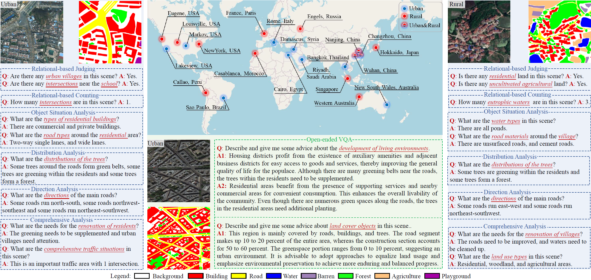

<h2 align="center">EarthVL: A Progressive Earth Vision-Language Understanding and Generation Framework</h2>

<h5 align="right">by <a href="https://junjue-wang.github.io/homepage/">Junjue Wang</a>,
<a href="http://rsidea.whu.edu.cn/">Yanfei Zhong</a>,
Zihang Chen,
<a href="http://zhuozheng.top/">Zhuo Zheng</a>, 
 Ailong Ma, and <a href="http://www.lmars.whu.edu.cn/prof_web/zhangliangpei/rs/index.html">Liangpei Zhang</a></h5>

[[`Paper`](https://arxiv.org/pdf/2601.02783)], 
[[`Dataset`](https://huggingface.co/datasets/Kingdrone-Junjue/EarthVLSet)]


<div align="center">
  
</div>

## News
- 2026/11/01, EarthVL has been accepted by [<b>IEEE TPAMI</b>](https://ieeexplore.ieee.org/xpl/RecentIssue.jsp?punumber=34) !!!
- 2026/01/06, New Global-LoveDA !!! We released the global-scale segmentation leaderboard at [<b>Global-LoveDA</b>](https://www.codabench.org/competitions/13040). Just zip all the test images into one file and submit it.
- 2026/01/06, The segmentation data is released at [[`Dataset`](https://huggingface.co/datasets/Kingdrone-Junjue/EarthVLSet)].
- 2026/01/06, We are preparing the code and data for EarthVL.
- 2024/09/25, EarthVL is the extension of our [<b>EarthVQA</b>](https://github.com/Junjue-Wang/EarthVQA) and [<b>LoveDA</b>](https://github.com/Junjue-Wang/LoveDA) projects.


#### Requirements:
- pytorch >= 1.1.0
- python >=3.6


### Install Ever + Segmentation Models PyTorch
```bash
pip install ever-beta
pip install git+https://github.com/qubvel/segmentation_models.pytorch
```
### Preparation
- Download Pre-trained vicuna-7B from hugging face: https://huggingface.co/lmsys/vicuna-7b-v1.5
- Unzip the data 

### Test

```bash
sh ./scripts/test.sh
```
### Train
```bash
sh ./scripts/train_generation.sh
```

## Citation
If you use EarthVL in your research, please cite our following papers.
```text
    @article{wang2026earthvl,
      title={EarthVL: A Progressive Earth Vision-Language Understanding and Generation Framework},
      author={Wang, Junjue and Zhong, Yanfei and Chen, Zihang and Zheng, Zhuo and Ma, Ailong and Zhang, Liangpei},
      journal={arXiv preprint arXiv:2601.02783},
      year={2026}
    }
    @article{wang2024earthvqa, 
        title={EarthVQA: Towards Queryable Earth via Relational Reasoning-Based Remote Sensing Visual Question Answering},
        url={https://ojs.aaai.org/index.php/AAAI/article/view/28357}, 
        DOI={10.1609/ai.v38i6.28357}, 
        author={Wang, Junjue and Zheng, Zhuo and Chen, Zihang and Ma, Ailong and Zhong, Yanfei}, 
        year={2024}, 
        month={Mar.},
        volume={38},
        pages={5481-5489}}
    @proceedings{wang2021loveda,
         author = {Wang, Junjue and Zheng, Zhuo and Ma, Ailong and Lu, Xiaoyan and Zhong, Yanfei},
         booktitle = {Proceedings of the Neural Information Processing Systems Track on Datasets and Benchmarks},
         editor = {J. Vanschoren and S. Yeung},
         pages = {},
         publisher = {Curran Associates, Inc.},
         title = {LoveDA: A Remote Sensing Land-Cover Dataset for Domain Adaptive Semantic Segmentation},
         url = {https://datasets-benchmarks-proceedings.neurips.cc/paper_files/paper/2021/file/4e732ced3463d06de0ca9a15b6153677-Paper-round2.pdf},
         volume = {1},
         year = {2021}
    }
```


## Star History

<a href="https://www.star-history.com/?repos=Junjue-Wang%2FEarthVL&type=date&legend=top-left">
 <picture>
   <source media="(prefers-color-scheme: dark)" srcset="https://api.star-history.com/chart?repos=Junjue-Wang/EarthVL&type=date&theme=dark&legend=top-left&sealed_token=tclzXUWuhSESMju1wByBan4RGLv9d2NF7zB52aHu7yRaiGV2mlspdYbS9UUPPLy0COrQ3d4jQgL6KvAUhD9IdW04C9u5gmzAYsx1ZyAiq7-iltwwnAB0o13_yDvnafRmZnMwUE1vsTgfYXEzzyKgqSwNCeUG3tGm5UuwymVvv3hi5NN0tvF1AiykE3nL" />
   <source media="(prefers-color-scheme: light)" srcset="https://api.star-history.com/chart?repos=Junjue-Wang/EarthVL&type=date&legend=top-left&sealed_token=tclzXUWuhSESMju1wByBan4RGLv9d2NF7zB52aHu7yRaiGV2mlspdYbS9UUPPLy0COrQ3d4jQgL6KvAUhD9IdW04C9u5gmzAYsx1ZyAiq7-iltwwnAB0o13_yDvnafRmZnMwUE1vsTgfYXEzzyKgqSwNCeUG3tGm5UuwymVvv3hi5NN0tvF1AiykE3nL" />
   
 </picture>
</a>
